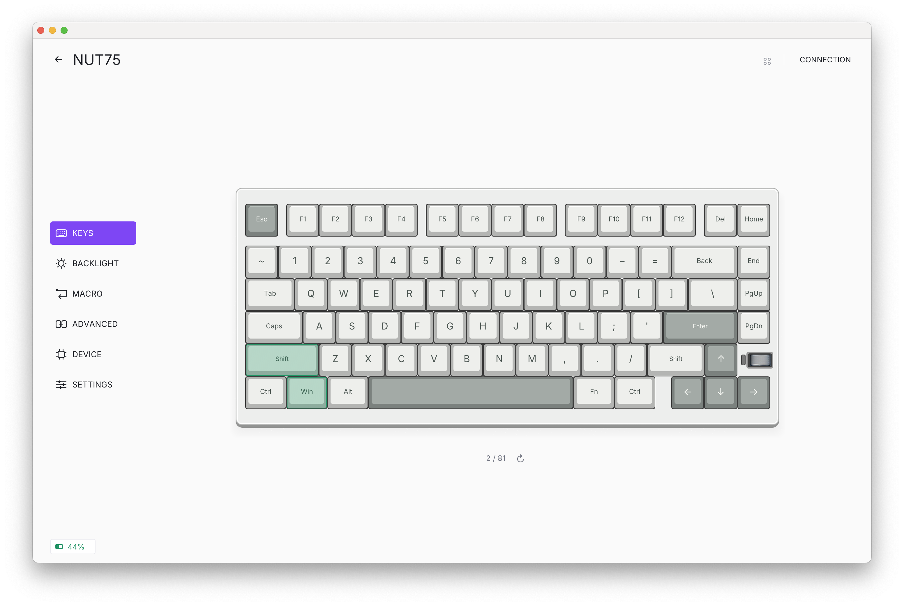
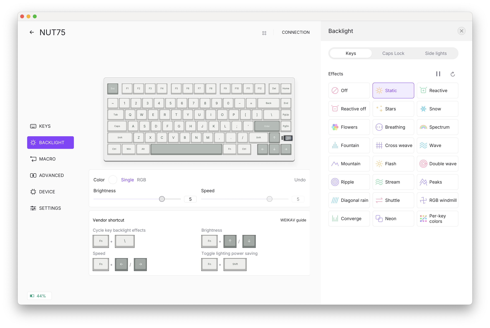

# Weikav Studio

A native desktop companion for the **WEIKAV NUT75**, available for **macOS and Windows**.

Customize your keyboard, preview lighting, edit macros and test your keys in one place. **NUT75 is the only supported model.**

[Website and screenshots](https://luongwnv.github.io/weikav-app/) - [Download](https://github.com/luongwnv/Weikav-Keyboard-Application/releases/latest) - [Report an issue](https://github.com/luongwnv/Weikav-Keyboard-Application/issues)

[Browse all app screens](https://luongwnv.github.io/weikav-app/screenshots.html)

## Install

- **macOS:** download the `.pkg` for Apple Silicon or Intel, open it and follow the installer. Weikav Studio is installed in Applications.
- **Windows:** download the x64 Setup `.exe` and follow the installer, or extract the portable `.zip` and run `Weikav Studio.exe`.

Current packages are not signed with an Apple Developer ID or Windows publisher certificate. Only download packages from this repository’s releases.

## Connect your keyboard

1. Close the WEIKAV web driver so it does not compete for the same device.
2. Connect a data-capable USB-C cable and press **Fn + T** to select USB mode, or use the NUT75 **2.4 GHz receiver**.
3. Open Weikav Studio. Choose your keyboard or select **Add device**.
4. Choose a feature in the left menu. Changes remain in your local profile until you select **Apply**.

The app reads the keyboard configuration before showing it as connected. Applying a configuration includes a read-back check. Errors stay visible until dismissed. The back arrow returns to the device list without disconnecting.

Hover over a device to reveal its **X** button. Removing a connected device disconnects its configuration session in the app. You can add it again later; local profiles are kept.

## Keys

Click a key on the keyboard model to assign a standard key, media control, mouse action, macro or device function. Switch between **Default** and **Fn** layers. The volume roller supports left rotation, right rotation and pressing.

Test keys directly on this screen. Tested keys stay green until you choose **Start again**. Caps Lock and volume roller activity appear on the keyboard model. Some firmware-handled Fn combinations are not reported to the computer.

## Backlight

Explore **24 lighting choices**, including custom per-key colors. The keyboard preview demonstrates movement before you apply it. Choose a color with the color wheel, RGB/hex fields, presets or saved colors, and adjust brightness, speed and direction when the selected effect supports them.

The **Keys**, **Caps Lock** and **Side lights** tabs each show the relevant manufacturer shortcuts as real model keycaps. The guide distinguishes a key’s backlight from the separate indicator next to the roller. [WEIKAV quick-start guide](https://drive.google.com/file/d/12tl04Z6Ol5kfUWCdcbDVPiEMCkWKF_vb/view).

Lighting previews are illustrative. Some effects use automatic RGB colors even when the firmware stores a selected color. Side-light and separate indicator control depend on firmware; these controls are unavailable in the app on the tested firmware 1.40.

## Macros

Choose a macro, name it, then record keys or add actions manually. Each action shows a keycap matching your keyboard model.

- Drag an action to reorder it; neighboring actions slide to make room.
- Select an action to edit its key, press/release state and delay, or delete that action.
- Use the detailed table for inline editing.
- Record delays, undo edits, duplicate a macro and check memory usage from the options menu.
- Assign the macro to a key in **Keys**, with once, repeat-count or press-again-to-stop playback.

## Advanced Keys

Select a key and choose **SOCD** for opposing-key priority, **MT** for separate tap/hold actions, **TGL** for toggled holding, or **CB** for a key combination. Review existing assignments below the keyboard and test input directly on the model.

## Device and Settings

**Device** contains operating-system mode, polling rate, sleep, debounce, Windows-key lock, F1–F12 swapping and N-key rollover. Available options are determined by the device configuration.

**Settings** contains keyboard finish, local profiles, language, appearance and connection details. Choose **light, dark or system** appearance and **Vietnamese, English, Simplified Chinese, Japanese, Korean, French, German or Spanish**. Language files and fonts are bundled and work offline.

Profiles can be named, imported and exported as JSON. Selecting a profile does not write it to the keyboard; use **Apply** when ready. Changing the keyboard finish updates its appearance in the app.

## Compatibility

- Configuration: **USB-C and NUT75 2.4 GHz receiver**.
- Bluetooth configuration is not supported.
- GIF/animation upload, audio/AI lighting, firmware updating and factory reset are not included.
- Physical hardware checks have been performed on macOS. Windows packages are built on Windows; Windows hardware behavior is not yet verified.

Weikav Studio is an independent application and is not affiliated with WEIKAV or Logitech. Keyboard artwork and vendor icons belong to their respective owners.
